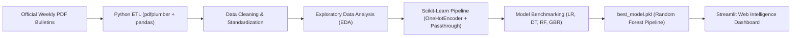

# 🐟 Sri Lankan Fish Market Price Intelligence & Forecasting Platform

[](https://www.python.org/)
[](https://streamlit.io/)
[](https://scikit-learn.org/)
[](https://opensource.org/licenses/MIT)

An end-to-end Machine Learning intelligence platform and decision-support system designed to monitor, analyze, and forecast weekly fish market prices across Sri Lanka's major wholesale and retail trading hubs (Peliyagoda Central Market).

---

## 📌 Executive Summary

Fish prices in Sri Lanka fluctuate intensely due to monsoon sea conditions, fuel inflation, consumer purchasing power, and volatile harbor arrivals. Traditional market participants rely on ad-hoc estimation, leading to pricing inefficiencies and supply imbalances.

This project delivers an **automated, data-driven intelligence pipeline**:
1. **Automated ETL**: Extracts unstructured tabular data from official Department of Fisheries and Aquatic Resources weekly market PDF bulletins.
2. **Exploratory Data Analysis (EDA)**: Analyzes wholesale vs. consumer price spreads, species volatility, and seasonal trends across 31 marine fish species.
3. **Machine Learning Pipelines**: Implements unified `scikit-learn` transformation pipelines comparing four regression architectures using chronological hold-out validation.
4. **Interactive BI Dashboard**: Deploys a 4-page, custom-styled dark-mode **Streamlit** web application for real-time scenario forecasting and market diagnostics.

---

## 🏗️ System Architecture



---

## 📊 Model Evaluation & Benchmarks

Models were trained on 780 historical records and evaluated on 196 strictly chronological held-out test records:

| Model | MAE (LKR) | RMSE (LKR) | $R^2$ Score | Key Characteristics |
| :--- | :---: | :---: | :---: | :--- |
| **Linear Regression** | 171.79 | 213.37 | 0.9385 | Fast baseline; captures broad linear relationships |
| **Decision Tree** | 177.35 | 217.28 | 0.9363 | Overfits on local partitions; highest test error |
| **Gradient Boosting** | 138.32 | 179.09 | 0.9567 | Sequential error correction; strong performance |
| **Random Forest (Best)** | **133.13** | **171.22** | **0.9604** | **Ensemble of 300 estimators; lowest variance & error** |

### 🔍 Analytical Finding: Feature Contribution & Autoregressive Dynamics
* **`Price_LastWeek`**: 92.1% relative predictive contribution.
* **`Price_2025`**: 6.3% relative predictive contribution.
* **Species & Market Tier**: Contributes to species-specific margin adjustments and consumer vs. wholesale markup pricing.

---

## 🖥️ Streamlit Web Application Features

The production application (`dashboard/app.py`) provides four functional workspaces:

1. **🌊 Market Overview**: Live KPI metric cards (average prices, active species count, top market movers, historical price index).
2. **🎯 Real-Time Price Prediction**: Interactive parameter selector (Species, Market Type, Target Week, Historical Price Lags) with dynamic estimate calculation and confidence bounds.
3. **📈 Market Analytics**: Interactive Plotly charts examining Wholesale vs. Retail margin spreads, monthly seasonal curves, and species volatility distributions.
4. **🧠 Model Insights**: Feature importance breakdowns, actual vs. predicted diagnostic scatter plots, and model architecture parameters.

---

## 📁 Repository Structure

```text
├── dashboard/
│   ├── app.py                      # 2,400+ line Streamlit application
│   └── .streamlit/config.toml      # Ocean theme styling configuration
├── data/
│   ├── raw/                        # Raw scraped & combined PDF extracts
│   └── processed/                  # Cleaned, standardized modeling dataset
├── models/
│   ├── best_model.pkl              # Serialized Random Forest pipeline artifact
│   └── best_model_name.txt         # Best model identifier
├── notebooks/
│   ├── Exploratory Data Analysis.ipynb  # Comprehensive EDA & visual analysis
│   └── Model Training.ipynb            # ML training, pipelines & evaluation
├── outputs/
│   ├── figures/                    # Exported high-resolution plots
│   └── results/                    # model_evaluation.csv & feature importances
├── requirements.txt                # Pinned production dependencies
└── README.md
```

---

## ⚡ Quickstart Guide

### 1. Clone the Repository
```bash
git clone https://github.com/Wasana1010/sri-lankan-fish-market-intelligence.git
cd sri-lankan-fish-market-intelligence
```

### 2. Set Up Virtual Environment & Install Dependencies
```bash
python -m venv venv
# On Windows:
venv\Scripts\activate
# On Linux/macOS:
source venv/bin/activate

pip install -r requirements.txt
```

### 3. Launch the Streamlit Dashboard
```bash
streamlit run dashboard/app.py
```
Open `http://localhost:8501` in your browser.

---

## 👩‍💻 Author
**Thilini Wasana**  
*Software Engineering Undergraduate — National Institute of Business Management (NIBM)*  
- LinkedIn: [thilini-wasana](https://www.linkedin.com/in/thilini-wasana-166117360)  
- Email: thiliniwasana1010@gmail.com
